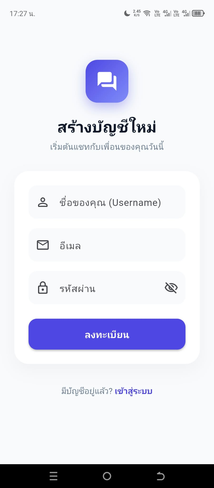
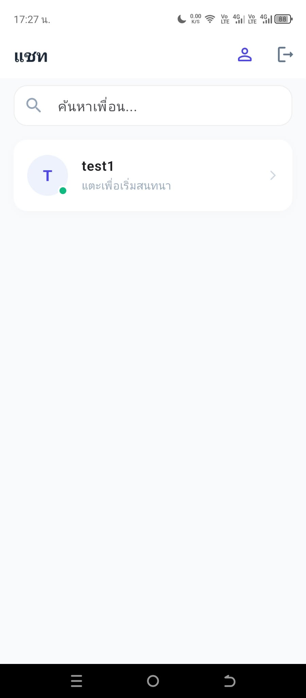
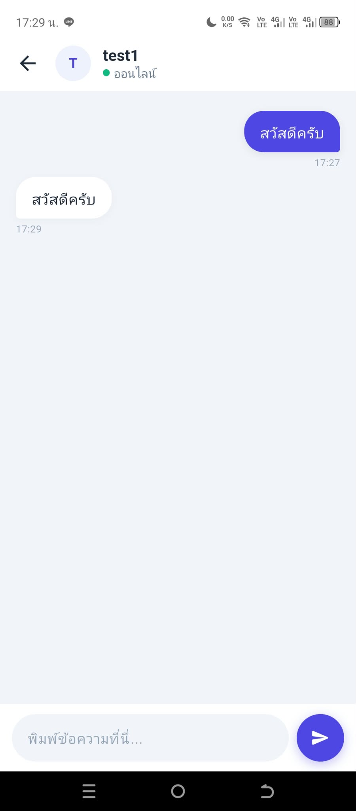
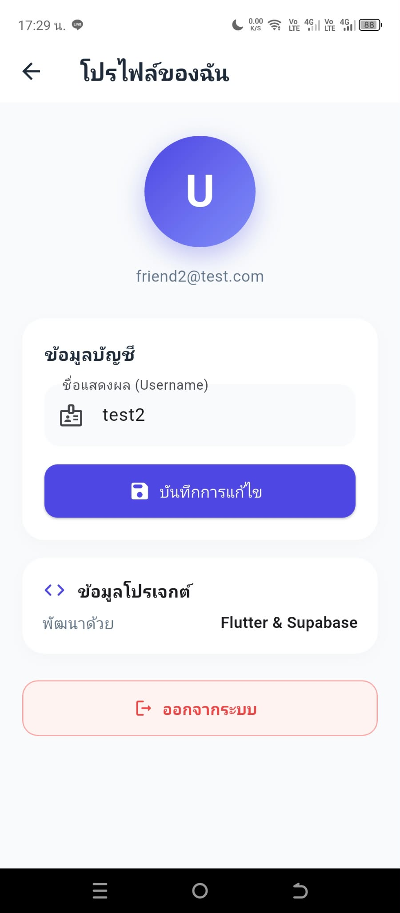

# แอพแชท

แอปพลิเคชันห้องสนทนาพัฒนาด้วย Flutter และใช้ Supabase เป็นฐานข้อมูลหลังบ้าน

## ผู้จัดทำ
- ศุภณัฐ ชมศรี [@Supanat30](https://github.com/Supanat30)
- ณัฐภัทร เลาว้าง

## ลิงก์ดาวน์โหลดและเอกสาร
- [ไฟล์.apk](https://github.com/Supanat30/app_chat/releases/tag/v1.2)
- [รายงาน PDF](docs/รายงานโครงงานในรายวิชา การพัฒนาโปรแกรมประยุกต์สำหรับอุปกรณ์เคลื่อนที่.pdf)
- [วิดีโอแนะนำแอปพลิเคชัน (15–30 วินาที)](https://youtu.be/xxxxxxx)

## ภาพหน้าจอการทำงาน (Screenshots)

  
  
  
  
  

